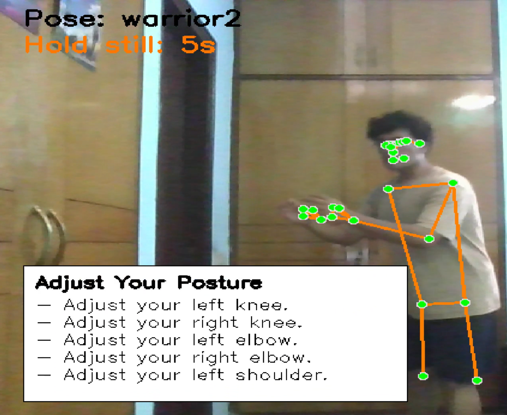
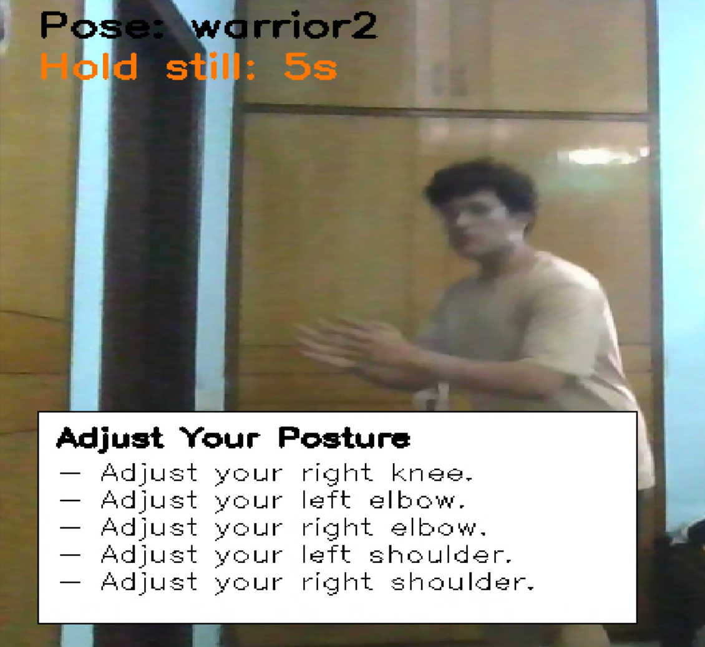

# Posture-Check: Yoga Pose Correction System

Posture-Check is a real-time yoga posture correction system built with computer vision. It uses MediaPipe to extract full-body landmarks and compares the user’s posture to predefined joint-angle ranges stored in `angles.json`. The system provides instant feedback, pose detection, posture hints, and a clean dark-mode UI panel.

## Features

- Real-time full-body detection using the webcam  
- Pose validation using predefined angle ranges  
- Two working modes:
  - **Auto Detect Pose** (auto-identifies user pose after stable detection)
  - **Manual Pose Selection**  
- Optional **live joint angle display** (toggle at start)  
- Newly designed **dark-mode side panel** with white text for readability  
- On-screen messages such as:
  - “Move back – full body not visible”
  - “Please start your yoga”
- Automatic pose detection after 5 seconds of stable posture  
- Always-on detailed posture hints  
- Hold-timer that requires **5 continuous seconds** of correct posture  
- Angle smoothing over multiple frames for stable analysis  
- Clean layout without grid lines (optional)  
- Structured, modular codebase with a separate dataset processing script  

## Technologies Used

- **Python 3**  
- **OpenCV** – camera interface, UI overlays  
- **MediaPipe** – pose landmark detection  
- **NumPy** – vector math and angle calculations  
- **JSON** – storing per-pose angle ranges  


## Project Structure

YogaPostureCorrection/
- angles.json          # Reference joint angle ranges for all poses - the actual output extraction.py produces
- analysis.py          # Main script for pose detection, hints, UI, and auto/manual modes
- extraction.py        # Builds angles.json from images inside dataset/
- dataset/             # Not included in this repo - see note below
- README.md            # Full project documentation

The `dataset/` folder (pose reference images used to build `angles.json`) isn't committed here -
the images were sourced from various sites for development and aren't mine to redistribute.
`angles.json` (the actual derived angle ranges) is included and is all you need to run
`analysis.py`. If you want to regenerate it yourself, drop your own pose images into
`dataset/<pose-name>/` and run `extraction.py`.

## Workflow

1. **Dataset → Angle Extraction**

   * `extraction.py` processes reference images in `Dataset/`
   * Generates standardized joint angle ranges
   * Stores everything inside `angles.json`

2. **Start System (analysis.py)**

   * User selects:

     * Auto Detect mode
     * OR Manual Selection mode
   * User chooses whether to enable/disable display of live joint angles

3. **Pre-start checks**

   * System ensures entire body is visible
   * Shows guidance messages if needed
   * Shows “Please start your yoga” when detection becomes stable

4. **Real-time Analysis**

   * MediaPipe extracts landmarks each frame
   * Angles are calculated and smoothed
   * Each angle is compared with the reference range
   * Dark-mode side panel shows:

     * Pose name
     * Hold timer progress
     * Detailed posture hints like:

       * “Left Knee: increase by 12”
       * “Right Shoulder: decrease by 8.5”
   * Optional live angles listed below hints

5. **Success Condition**

   * When the user holds the correct pose for **5 seconds continuously**,
     the system marks the session complete.

---

## Required Libraries

Install the dependencies:

```bash
pip install opencv-python mediapipe numpy
```


## Run the System

Inside the project folder:

```bash
python analysis.py
```

At the start, you will be prompted to:

1. Choose **Auto Detect** or **Manual Selection**
2. Enable or disable **live angle display**


## Future Enhancement

* Add more poses and refine existing angle metadata
* Save performance history and analytics
* Add voice instructions and auditory alerts
* Build a web interface (HTML/JS or React)
* Export session summary reports (CSV or PDF)


## Result Examples

### Hints-only View



Shows pose name, alignment hints, and hold progress.

### Hints + Live Angles View



Displays detailed angle values in addition to corrective hints.

