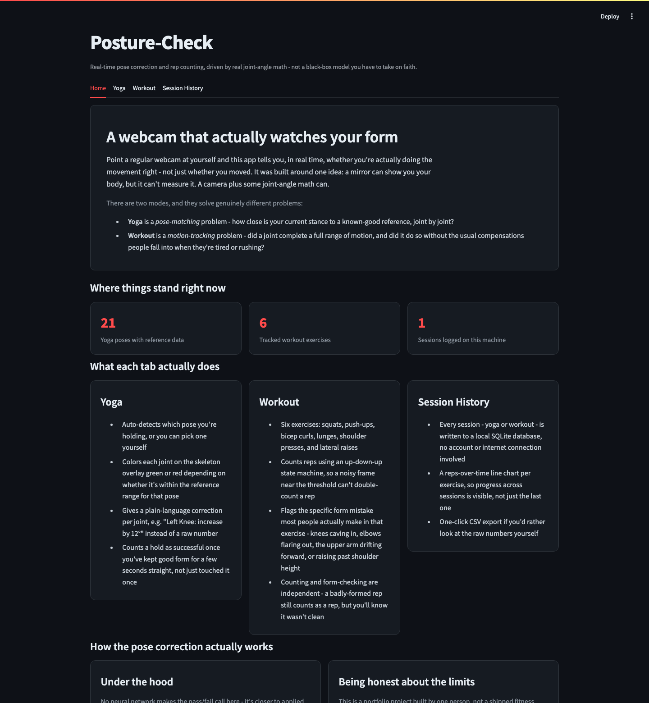
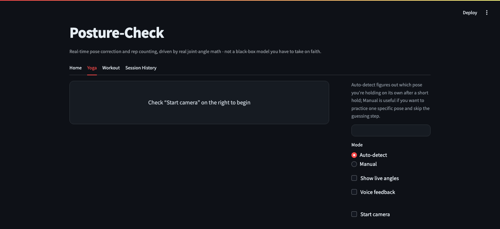
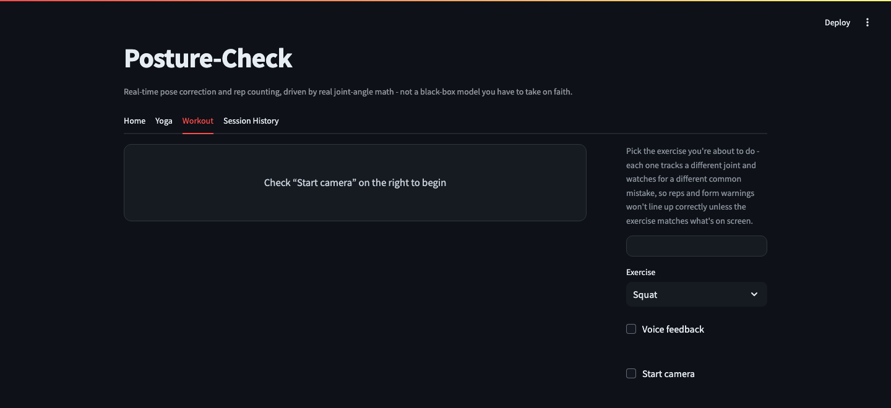

# Posture-Check

A real-time AI fitness coach built on computer vision: holds you to real joint-angle references
for yoga poses, counts reps for dynamic exercises, and catches bad form on both.

## Why this exists

Pose-estimation demos usually stop at "draw a skeleton on the webcam feed." The actual useful
part - telling someone *what's wrong* and *by how much* - needs a reference to compare against
and a real rule for turning a joint angle into an instruction a person can act on. This project
builds that: real joint-angle ranges mined from reference images (yoga), a rep-counting state
machine with its own form checks (workout), and a dashboard that remembers what you did session
to session.

## Screenshots

**Home** - real stats pulled live from the data on disk, plus an honest breakdown of what each
tab does and how the pose-correction math actually works:



**Yoga mode** - auto-detect vs. manual pose selection, live angle display, and voice feedback,
before the camera starts:



**Workout mode** - pick an exercise, see its rep-counting joint and form check explained up
front:



## How it works

**Yoga mode** - MediaPipe extracts 33 body landmarks per frame. For each of 10 tracked joints
(knees, elbows, shoulders, hips, neck, spine), the angle between its three defining landmarks is
computed via the standard vector dot-product formula (`arccos` of the normalized dot product).
Each pose has a reference min/max range per joint, mined from sample images (`extraction.py`) and
widened by a fixed tolerance for real-time webcam use. A live angle outside the reference range
becomes a corrective hint ("Left Knee: increase by 12.0°"); holding every angle in range for 5
continuous seconds completes the pose.

**Workout mode** - a different problem: counting reps of a dynamic exercise (squats, push-ups,
bicep curls, lunges, shoulder presses, lateral raises), not holding a static position. Each
exercise tracks one representative joint angle through a simple up/down state machine - crossing
below a "down" threshold then back above an "up" threshold counts one rep, which avoids
double-counting on a single noisy frame near a raw threshold. A second, independent check flags
common form mistakes for that exercise (e.g. knees caving inward on a squat) - a rep still counts
if the form is bad, since you did complete it, but the warning is logged and voiced.

## Features

- **Yoga**: auto-detect or manual pose selection, live angle display, a skeleton overlay colored
  red/green per joint so you can see exactly what's off, 5-second hold-to-complete
- **Workout**: rep counting for six exercises (squats, push-ups, bicep curls, lunges, shoulder
  presses, lateral raises), with real-time form warnings (not just a rep count)
- **Session history**: every session (yoga or workout) is logged to a local SQLite database, with
  a reps-over-time trend view and a CSV export
- **Voice feedback**: offline text-to-speech announces hints/form corrections out loud, no
  internet/API required
- **Two ways to run it**: a Streamlit web app (`app.py`, recommended) or the original OpenCV
  window (`analysis.py`)

## How accurate is auto-detect, really?

Leave-one-out evaluation (`evaluate.py`): for every reference image with at least one sibling in
its pose folder, hold it out, rebuild that pose's angle range from the remaining images, and check
whether auto-detect correctly identifies the held-out image against all 21 poses.

**Result: 88.9% accuracy overall** (81 images evaluated). Per-pose, most poses hit 100%, but a few
are noticeably weaker - bow-pose (33%), and locust/reverse-warrior/sphinx/triangle/upward-salute
(67% each) - which tracks with those poses having only 3 reference images each. This is a small-
sample estimate, not a rigorous benchmark, and it's reported honestly rather than only quoting the
headline number.

## A real, known data limitation

Reference images per pose range from 3 to 7 - thin enough that `extraction.py` has to widen each
joint's derived range by a fixed ±25° to have any real-time tolerance, rather than deriving that
tolerance from genuine statistical spread. The `dataset/` folder itself isn't included in this
repo (see below) - if you want to improve on this, dropping more varied reference images into
`dataset/<pose-name>/` and re-running `extraction.py` is the direct way to raise the evaluation
numbers above.

## Project structure

```
YogaPoseDetection/
  geometry.py      # shared landmark/angle math
  feedback.py       # yoga pose comparison
  renderer.py        # skeleton overlay + side panel drawing
  workout.py          # rep counting + form checks
  storage.py            # session history (SQLite)
  voice.py                # offline text-to-speech
  extraction.py             # builds angles.json from dataset/ images
  evaluate.py                # leave-one-out accuracy evaluation
  analysis.py                  # OpenCV-window entry point
  app.py                        # Streamlit entry point (recommended)
  angles.json                    # derived joint-angle ranges (included)
  dataset/                        # NOT included - see note below
  tests/                            # pytest coverage for the pure logic
```

`dataset/` (the pose reference images `extraction.py`/`evaluate.py` run against) isn't committed
here - the images were sourced from various sites during development and aren't mine to
redistribute. `angles.json` (the actual derived ranges) is included and is all `analysis.py`/
`app.py` need to run. Drop your own images into `dataset/<pose-name>/` if you want to regenerate
or evaluate it yourself.

## Setup

```bash
pip install -r requirements.txt
```

## Run it

**Streamlit app (recommended):**

```bash
cd YogaPoseDetection
streamlit run app.py
```

(Streamlit looks for its theme config relative to the current directory, not the script's own
location - running it from the repo root instead would still work, but without the custom
theme.)

**Original OpenCV window:**

```bash
cd YogaPoseDetection
python analysis.py
```

**Run the tests:**

```bash
cd YogaPoseDetection
pytest tests/
```

## Limitations

- Single-person only - multiple people in frame will confuse the pose detector
- Sensitive to camera angle and lighting, like any single-camera pose-estimation setup
- The thin reference dataset (see above) is the main lever for improving accuracy further
- Form checks (knee valgus, elbow flare, upper-arm drift) are reasonable heuristics for a demo,
  not biomechanically validated coaching advice

## What I'd improve with more time

- A proper evaluation set captured specifically for testing (not reused training images)
- More exercises and poses, each with enough reference images for real statistical ranges
- A proper rolling, continuous voice-feedback mode instead of the current cooldown-based one
