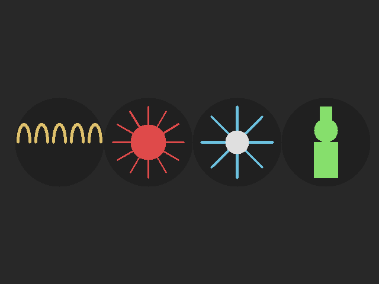
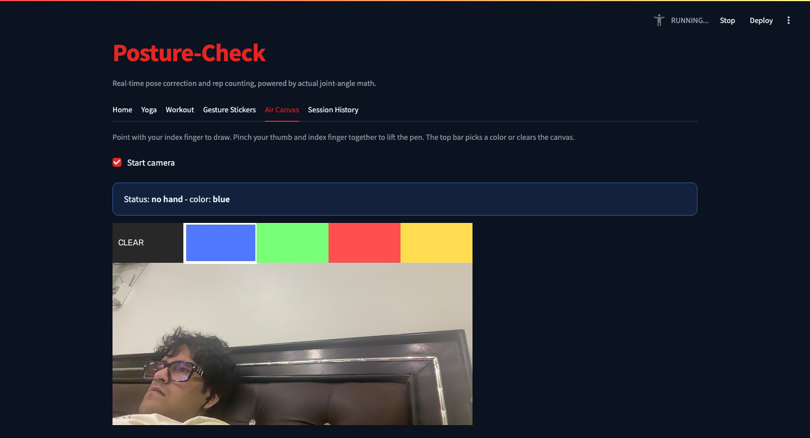
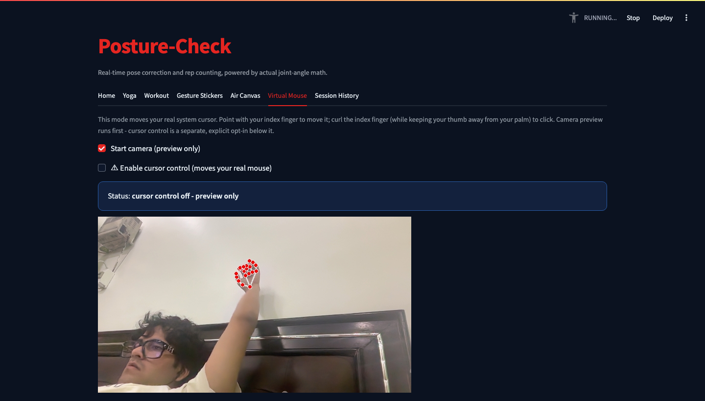
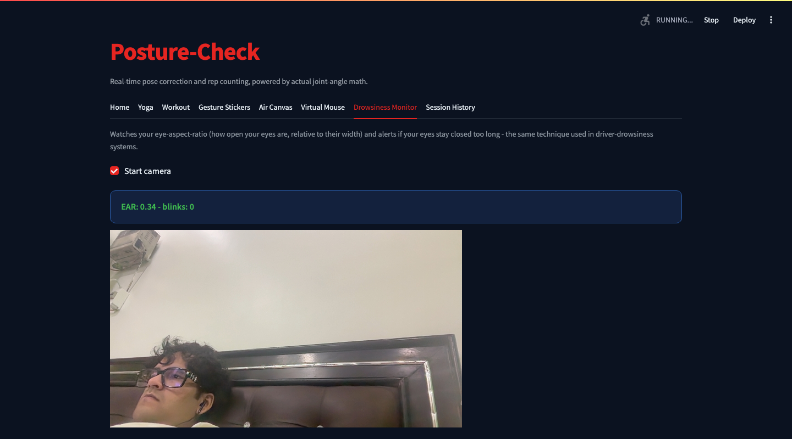

# Posture-Check

    

A computer vision playground built on one webcam, powered by three
MediaPipe trackers (Pose, Hands, Face Mesh) feeding six real-time modes:
yoga form correction with live joint-angle feedback and auto pose
detection, workout rep counting across six exercises with form checks,
hand-gesture recognition that triggers procedurally-drawn sticker overlays,
an air canvas you draw in with your fingertip, a hand-tracked virtual
mouse, and a drowsiness monitor built on eye-aspect-ratio tracking. Every
Yoga/Workout session is logged to SQLite with a reps-over-time trend and a
personal-bests summary, and feedback is spoken through offline
text-to-speech.

## Screenshots







## How to run

```bash
pip install -r requirements.txt
cd YogaPoseDetection
streamlit run app.py
```

On macOS, Virtual Mouse needs Accessibility permission granted to the
terminal/IDE (System Settings → Privacy & Security → Accessibility).

Tests: `cd YogaPoseDetection && pytest tests/`
